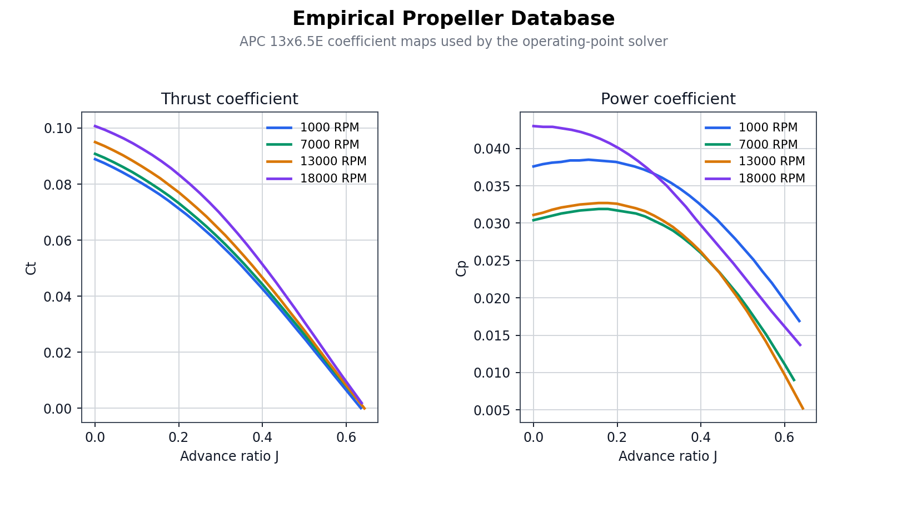
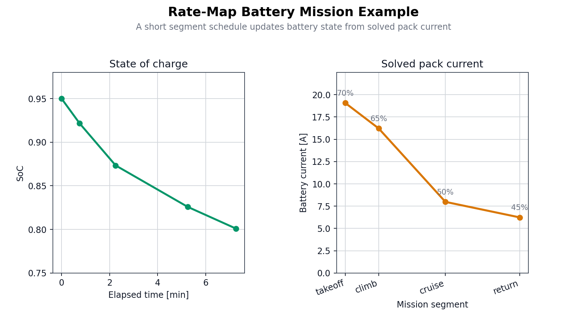

## About

PyThrust is an open-source framework for electric propulsion system analysis, co-design, and parameter optimization in UAV applications. It can be used for multidisciplinary design optimization (MDO) within OpenMDAO. It includes steady-state performance solvers and database search tools to map theoretical designs onto real-world brushless motor and propeller catalogs.

## Feature Visuals

| Empirical Propeller Database | Rate-Map Battery Mission |
| :---: | :---: |
|  |  |

## Documentation

The full documentation is available at:

**https://setuav.github.io/PyThrust/**

Key sections:

- [Getting Started](https://setuav.github.io/PyThrust/getting_started/)
- [Propulsion Solver](https://setuav.github.io/PyThrust/usage/)
- [Examples](https://setuav.github.io/PyThrust/examples/)
- [Propulsion and Battery Theory](https://setuav.github.io/PyThrust/theory/)
- [Component Databases](https://setuav.github.io/PyThrust/databases/)

## License

PyThrust is licensed under the Apache License, Version 2.0 (the "License"). See [LICENSE](https://github.com/Setuav/PyThrust/blob/main/LICENSE) for the full license.

## Copyright

Copyright (c) 2026 Setuav. All rights reserved.
