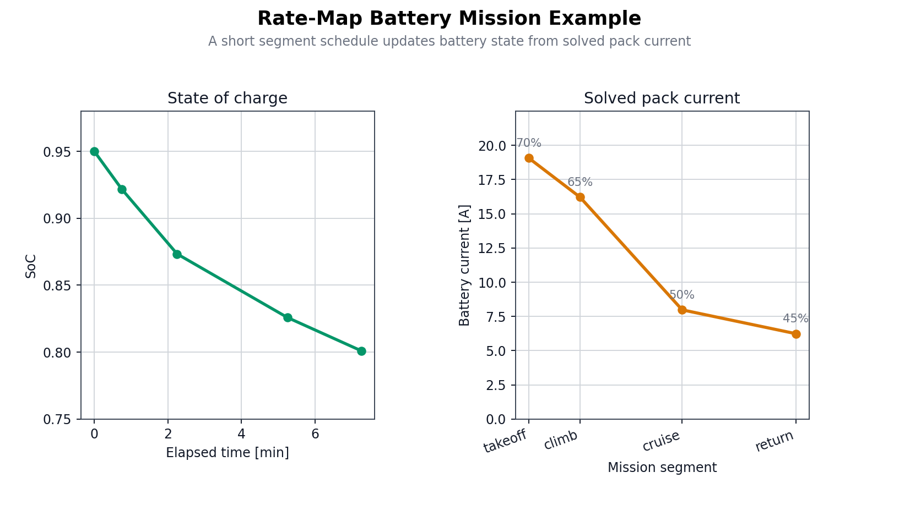

# Examples

PyThrust includes runnable examples that show the main workflows: solving
propulsion models and inspecting rate-map battery behavior. They load the
example battery cell through `pythrust.dataset_dir()`.

```bash
PYTHONPATH=. python examples/<example_name>.py
```

## Requirements

| Example | Extra dependencies |
|---|---|
| `rate_map_battery_point_states.py` | Core PyThrust dependencies |
| `rate_map_battery_mission.py` | Core PyThrust dependencies |

Install PyThrust from the repository root:

```bash
pip install -e .
```

## Rate-Map Battery Point States

Script:

```bash
PYTHONPATH=. python examples/rate_map_battery_point_states.py
```

This example loads `data/batteries/example_liion_cell.json`, applies a `4S2P`
pack topology, and evaluates the same state of charge under several requests.

It demonstrates:

| Query | Meaning |
|---|---|
| `state_at_current` | Terminal voltage and power at a requested pack current |
| `state_at_c_rate` | Current/voltage behavior at a requested cell C-rate |
| `state_at_voltage` | Current required to hold a requested pack voltage |
| `state_at_power` | Current and voltage for a requested pack power |
| `state_at_load_resistance` | Battery behavior under a resistive load |
| `state_at_power_loss` | Battery behavior for a requested internal loss power |
| Infeasible power | How the model reports a power limit |

This example is intentionally independent from the propulsion solver. It
validates the battery model surface before mission or solver integration.

## Rate-Map Battery Mission

Script:

```bash
PYTHONPATH=. python examples/rate_map_battery_mission.py [PER3_13x65E.dat]
```

This example couples `RateMapBattery` to `PropulsionSolver` over a short
segment schedule with a SunnySky X2820 KV860 motor, entered from its datasheet,
and the APC 13x6.5E propeller. The argument is an APC performance file; without
it the example uses the copy kept in `tests/data/`. Each segment solves the propulsion operating point
using the current battery state, reports thrust, pack current and voltage, then
integrates state of charge from the solved battery current.

It demonstrates:

| Step | Meaning |
|---|---|
| Load cell data | Use `data/batteries/example_liion_cell.json` with explicit series and parallel counts |
| Solve segment | Pass `battery_state` into `solve_operating_point(...)` |
| Read outputs | Inspect `battery_voltage_v` and `battery_current_a` on `OperatingPoint` |
| Advance state | Use `integrate_current(...)` to update SoC and delivered energy for the next segment |


