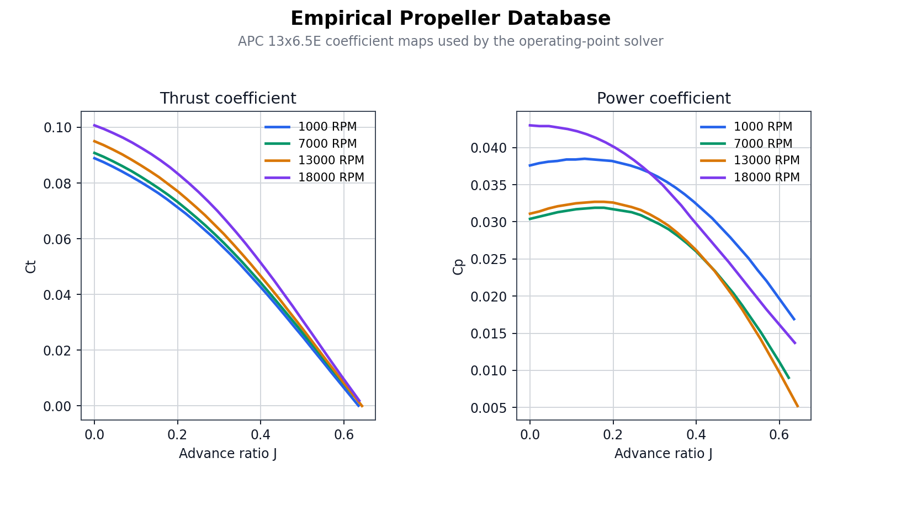
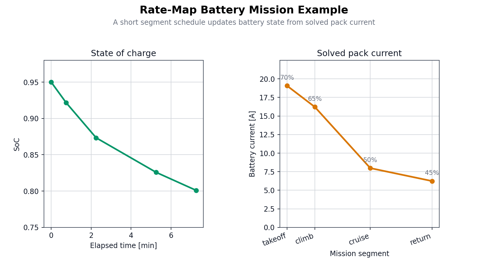

# PyThrust

Welcome to the official documentation for **PyThrust** - an open-source Python framework for electric propulsion system analysis, co-design, and parameter optimization in UAV applications.

PyThrust combines empirical propeller data, brushless motor models, battery/system loss modeling, and OpenMDAO integration so UAV designers can move from theoretical propulsion sizing to real component choices with traceable calculations.

---

## Core Capabilities

Electric UAV propulsion design usually crosses several domains: aerodynamics, motor electrical behavior, battery loading, and mission constraints. PyThrust keeps those pieces in one workflow:

-   **Operating-point solver**

    Solve equilibrium RPM, thrust, torque, current, voltage, power, and efficiency for a coupled motor-propeller-battery system.

-   **Manufacturer data**

    Read APC propeller performance files and enter motor datasheet constants, instead of sizing only against abstract component assumptions.

-   **Battery-aware analysis**

    Use fixed-voltage batteries for quick studies or rate-map batteries when voltage sag and state of charge matter.

-   **Optimization**

    Use the solver inside OpenMDAO co-design workflows.

---

## Feature Visuals

| APC Propeller Coefficients | Rate-Map Battery Mission |
| :---: | :---: |
|  |  |

## Explore the Docs

-   **Getting Started**

    Install PyThrust, add optional extras, and run the first operating-point solve.

    [Open guide](getting_started.md)

-   **Propulsion Solver**

    Review solver inputs, equations, feasibility rules, result fields, and usage examples.

    [Open guide](usage.md)

-   **Battery Model**

    Understand fixed-voltage and rate-map batteries, JSON datasets, and solver integration.

    [Open reference](battery_model.md)

-   **Examples**

    Run battery and mission workflows from the repository.

    [Open examples](examples.md)

-   **Theory**

    Trace the propeller, motor, electrical loss, and battery equations used by the solver.

    [Open theory](theory.md)

-   **API Reference**

    Find the main classes, data file readers, and OpenMDAO wrapper.

    [Open API](api_reference.md)

