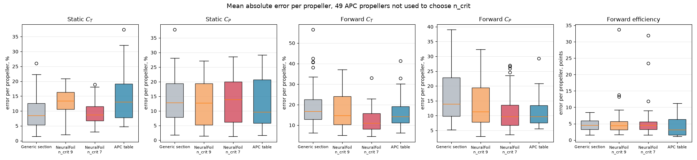
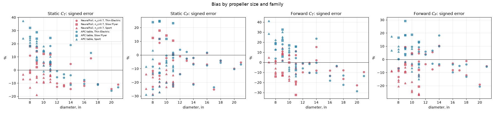
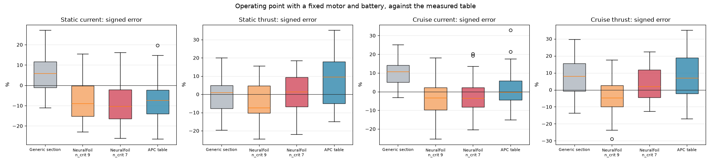

# Validation

How close PyThrust's propeller models come to wind-tunnel measurements, for every APC propeller
that the [UIUC Propeller Database](https://m-selig.ae.illinois.edu/props/propDB.html) measured
and APC publishes a geometry file for: 75 propellers, 7 to 21 inches, in three families.

| Family | Propellers | Airfoils |
|---|---:|---|
| Thin Electric (E) | 34 | E63 at the root to APC12 (NACA 4412) |
| Sport | 30 | CLARK-Y |
| Slow Flyer (SF) | 11 | E63, or E63 to APC12 |

## Method

Four propeller models are compared with UIUC's static tests (thrust and power coefficients
against RPM) and forward-flight runs (against advance ratio, at a few RPM each):

- **Blade-element model, NeuralFoil polars**: APC's geometry file read with
  `read_apc_geometry(path, apc_airfoil_polars(n_crit))`.
- **Blade-element model, generic section**: the same geometry with the example section of the
  QPROP user guide on every station.
- **APC table**: APC's own performance file, read with `read_apc`. It is a computation, not a
  measurement.

`n_crit` was chosen on every third propeller of each family (26) and the models compared on the
other 49. The error of a propeller is the mean over its points; forward points with a measured
thrust coefficient below 0.02 are left out, where relative errors lose meaning.

## Coefficients

Mean absolute error per propeller, the 49 test propellers (efficiency in percentage points):

| Model | Static $C_T$ | Static $C_P$ | Forward $C_T$ | Forward $C_P$ | Forward efficiency |
|---|---:|---:|---:|---:|---:|
| Generic section | 9.6% | 14.3% | 20.0% | 16.7% | 4.7 |
| NeuralFoil, `n_crit` 9 | 13.3% | 12.5% | 17.1% | 14.3% | 5.3 |
| **NeuralFoil, `n_crit` 7** | **9.2%** | 13.5% | **12.3%** | 11.5% | 5.5 |
| APC table | 14.5% | 12.5% | 16.0% | 11.3% | 4.0 |



- With NeuralFoil polars the blade-element model is about as accurate as APC's own tables, and
  better in thrust.
- `n_crit` 7 and 5 fit equally well (mean errors 11.58% and 11.59% on the calibration set); 9,
  for a quiet wind tunnel, makes the slow, low-Reynolds-number points lose too much lift. The
  default is 7.
- The model's and APC's errors go together: per propeller their static power errors correlate at
  0.93, their thrust errors at 0.6 to 0.7. Much of what is left is common to both computations.

## By family

Mean signed error over all propellers of a family:

| Family | Model | Static $C_T$ | Static $C_P$ | Forward $C_T$ | Forward $C_P$ |
|---|---|---:|---:|---:|---:|
| Thin Electric | NeuralFoil, `n_crit` 7 | −3.7% | −6.1% | −2.5% | −1.6% |
| | APC table | +3.1% | −4.7% | +0.2% | +3.1% |
| Sport | NeuralFoil, `n_crit` 7 | −6.1% | −20.0% | −3.7% | −14.5% |
| | APC table | +13.6% | −14.6% | +10.0% | −0.5% |
| Slow Flyer | NeuralFoil, `n_crit` 7 | +10.6% | +7.1% | −17.1% | −9.0% |
| | APC table | +17.9% | +11.4% | +9.0% | +9.6% |



- **Thin Electric**: within a few percent on average.
- **Sport**: the model gives 15 to 20% too little power; APC's table, 15% too little static
  power.
- **Slow Flyer**: forward thrust 17% low. These thin, flexible blades bend under load, which
  neither computation models; expect errors of 15 to 20%.

## Operating points

With a fixed-voltage battery and a motor whose no-load speed is 1.25 times the propeller's median
static test RPM, at full throttle, static and at an advance ratio of 0.3, the measured table being
the truth (49 test propellers, mean absolute error):

| Model | Static current | Static thrust | Cruise current | Cruise thrust |
|---|---:|---:|---:|---:|
| Generic section | 8.9% | 7.9% | 10.4% | 11.1% |
| NeuralFoil, `n_crit` 7 | 11.2% | 7.8% | 7.4% | 8.3% |
| APC table | 11.0% | 12.3% | 6.7% | 12.6% |



The motor holds the RPM within 0.3%, so the power error shows in the current and the thrust error
in the thrust, each somewhat smaller than in the coefficients.

## Range

The measurements cover APC propellers of 7 to 21 inches, mostly below 8000 RPM. Above that, on
APC's own grid of RPM and advance ratio, the model gives 5 to 10% more thrust and power than
APC's tables, with no measurement to say which is right. The section lift has the
Prandtl-Glauert factor but the drag does not rise as the tip nears the speed of sound, so results
at high tip Mach numbers are outside what was validated.

## Reproducing

```bash
PYTHONPATH=. python validation/apc_uiuc.py   # downloads into validation/.cache
PYTHONPATH=. python validation/report.py     # tables, and the figures on this page
```

The data is downloaded from UIUC and APC on the first run and not kept in the repository.
