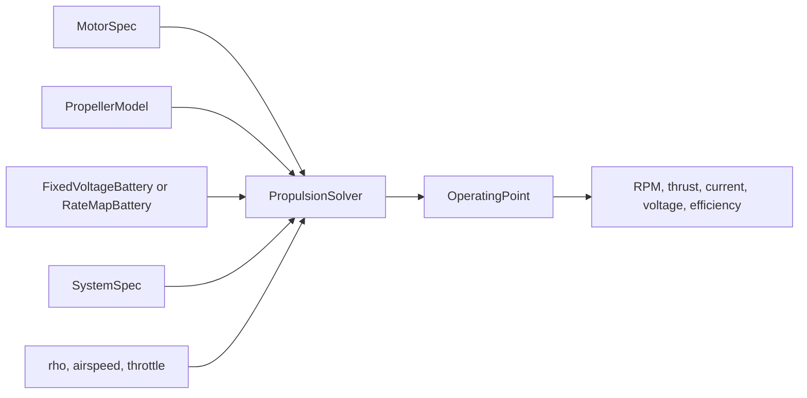

# Solving an Operating Point

This guide describes how PyThrust solves a motor-propeller operating point and how to interpret the result.

!!! question "Core solver question"
    Given a motor, propeller, battery, throttle, and airspeed, what shaft RPM makes the electrical motor model and propeller aerodynamic load agree?

!!! abstract "Use this page when"
    You are wiring the solver into an analysis script, checking why a point is infeasible, or confirming how battery voltage enters the RPM root solve.

---

## Solver Inputs

The operating-point solver combines five inputs:

| Input | Class or value | Purpose |
|---|---|---|
| Motor | [`MotorSpec`](reference/motor.md) | Kv, winding resistance, no-load current, current limit, optional higher-order loss terms |
| Battery | [`FixedVoltageBattery` or `RateMapBattery`](reference/battery.md) | Fixed pack voltage or state-dependent pack voltage from cell curves |
| System | [`SystemSpec`](reference/propulsion_solver.md) | Lumped resistance for ESC, battery internal resistance, wiring, and connectors |
| Propeller | A [`PropellerModel`](reference/propellers.md), such as `TablePropeller` or `BladeElementPropeller` | Thrust and torque at a given density, airspeed and RPM |
| Flight condition | `rho`, `airspeed_mps`, `throttle` | Air density, freestream speed, and commanded voltage fraction |

---

## What the Solver Does



For each candidate RPM the solver asks the propeller model for thrust and
torque, turns the torque into motor current and voltage, and compares the
voltage the motor needs with the voltage the throttle applies. The RPM where
they match is the operating point. The equations, the RPM search, the result
fields and the feasibility rules are in the
[Propulsion Solver reference](reference/propulsion_solver.md).

---

## Example Usage

### Tabulated propeller

Here is a complete example showing how to read a propeller file, define specifications, and solve for an operating point. It needs the APC performance file `PER3_13x65E.dat` (see [Tabulated Propeller](reference/table_propeller.md)):

```python
from pythrust.battery import FixedVoltageBattery
from pythrust.io import read_apc
from pythrust.motor import MotorSpec
from pythrust.propulsion import (
    PropulsionSolver,
    SystemSpec,
)

propeller = read_apc("PER3_13x65E.dat")

motor = MotorSpec(
    kv_rpm_per_v=860.0,
    resistance_ohm=0.0258,
    no_load_current_a=1.3,
    current_max_a=65.0,
)

battery = FixedVoltageBattery(
    voltage_v=14.8,
    discharge_efficiency=1.0,
)

system = SystemSpec(resistance_ohm=0.05)

solver = PropulsionSolver()
point = solver.solve_operating_point(
    motor=motor,
    battery=battery,
    system=system,
    propeller=propeller,
    rho=1.225,
    airspeed_mps=15.0,
    throttle=0.7,
)

print(f"RPM             : {point.rpm:.1f}")
print(f"Thrust          : {point.thrust_n:.2f} N")
print(f"Motor Current   : {point.motor_current_a:.2f} A")
print(f"Battery Voltage : {point.battery_voltage_v:.2f} V")
print(f"Battery Current : {point.battery_current_a:.2f} A")
print(f"Battery Power   : {point.battery_power_w:.1f} W")
print(f"Feasible        : {point.is_feasible}")
print(f"Reason          : {point.infeasible_reason}")
```

### Blade-element propeller

With a QPROP propeller file, the propeller is computed from its blade geometry
instead of a table; a QPROP motor file gives the motor (see
[Blade-Element Propeller](reference/blade_element_propeller.md) and
[Motor](reference/motor.md)):

```python
from pythrust.io import read_qprop_motor, read_qprop_propeller
from pythrust.propeller import BladeElementPropeller

propeller = BladeElementPropeller(read_qprop_propeller("prop.txt"))
motor = read_qprop_motor("motor.txt", current_max_a=40.0)

point = solver.solve_operating_point(
    motor=motor,
    battery=battery,
    system=system,
    propeller=propeller,
    rho=1.225,
    airspeed_mps=15.0,
    throttle=0.7,
)
```

### Rate-map battery

For a rate-map battery, load a cell dataset, create an explicit battery state,
and pass that state into the solver:

```python
from pythrust import dataset_dir
from pythrust.battery import BatteryState, RateMapBattery

battery = RateMapBattery.from_json(
    dataset_dir() / "batteries" / "example_liion_cell.json",
    series=4,
    parallel=2,
)
state = BatteryState(soc=0.85)

point = solver.solve_operating_point(
    motor=motor,
    battery=battery,
    battery_state=state,
    system=system,
    propeller=propeller,
    rho=1.225,
    airspeed_mps=10.0,
    throttle=0.6,
)
```
